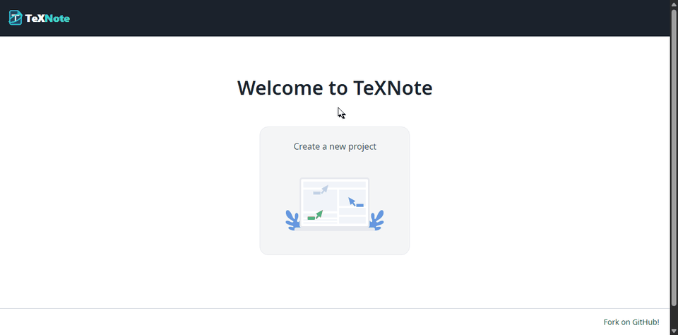

<p align="center">
  <picture>
    <source media="(prefers-color-scheme: dark)" srcset="logos/TeXNote-logo-dark.svg">
    <source media="(prefers-color-scheme: light)" srcset="logos/TeXNote-logo-light.svg">
    
  </picture>
</p>

<h3 align="center">The Autonomous, Sovereign Desktop LaTeX Studio</h3>

<p align="center">
  <a href="#-license--attributions"></a>
  
  
  
  
</p>

---

## ⚡ Overview

**TeXNote** is an open-source, 100% offline desktop LaTeX Studio engineered for researchers, engineers, academics, and students. It brings the beloved, productivity-focused workflow of modern web editors directly to your local workstation—with zero telemetry, zero cloud dependencies, and zero subscriptions.

- **Author**: **Rijwan Ansari**
- **Company**: **IRSpace**
- **License**: **GNU Affero General Public License v3.0 (AGPLv3)**
- **Default Port**: **`7777`** (`http://localhost:7777`)

<p align="center">
  
</p>

---

## 📥 Downloads & Pre-Built Installers

If you are an end-user looking to install and run TeXNote immediately without building from source, please download the official standalone installers from our website or GitHub Releases:

🌐 **Official Website & Downloads**: **[https://texnote.irspace.in/](https://texnote.irspace.in)**  
📦 **GitHub Releases**: **[https://github.com/rij1/texnote/releases](https://github.com/rij1/texnote/releases)**

### Available Pre-Built Packages:
- **🪟 Windows Standalone Offline Installer (`.exe`)**: Single-file setup wizard with bundled TeX Live engine, automated WSL2 initialization, Desktop shortcuts, and uninstaller.
- **⚡ Windows Online Bootstrapper (`.exe`)**: Lightweight ~75 KB web installer that downloads and imports the latest engine components from official releases.
- **🐧 Linux Standalone Installer (`.sh`)**: Self-extracting package with desktop menu integration, global CLI launcher, and systemd service orchestration.

---

## 🌟 Key Features

- **🛡️ 100% Sovereign & Air-Gapped**: Runs entirely offline with zero cloud telemetry, no analytics beacons, and no tracking pings. Your confidential research, notes, and papers remain strictly on your local hardware.
- **🎨 Overleaf-Inspired Workflow & Obsidian UI**: Polished split-pane writing experience with synchronized real-time PDF preview, CodeMirror syntax highlighting, document outline explorer, and custom dark/light themes.
- **📄 Native CTAN TeX Live Compilation**: Direct local integration with `pdflatex`, `xelatex`, `lualatex`, `latexmk`, `bibtex`, and `tikz` on your CPU with sub-second feedback.
- **⚡ Dedicated Native Runner**: Built-in C# desktop supervisor ([`Launcher.cs`](launcher/Launcher.cs)) featuring active health checks and persistent loopback keepalive on port **`7777`**.
- **🗄️ Zero-Docker Local Mesh**: Coordinates local MongoDB, in-memory Redis, and specialized document synchronization microservices natively over loopback (`127.0.0.1`), booting in under 2 seconds.

---

## ⚙️ System Architecture

TeXNote coordinates an internal suite of modular microservices connected over the local loopback interface (`127.0.0.1`):

```
+---------------------------------------------------------------------------------+
|                                 USER BROWSER                                    |
|                            http://localhost:7777                                |
+----------------------------------------+----------------------------------------+
                                         | HTTP / WebSockets
                                         v
+---------------------------------------------------------------------------------+
|                         TeXNote Web Service (Port 7777)                         |
|             Express HTTP Server • Modern Theme • WebSocket Proxy                |
+----+-------------------+-------------------+-------------------+----------------+
     |                   |                   |                   |
     v                   v                   v                   v
+------------+     +------------+     +------------+     +------------------------+
| Real-Time  |     |  Docstore  |     | Filestore  |     |  CLSI Compiler Engine  |
| Port 3026  |     | Port 3016  |     | Port 3009  |     |       Port 3013        |
| (Socket.IO)|     | (Documents)|     | (Binaries) |     | (pdflatex / latexmk)   |
+------------+     +------------+     +------------+     +-----------+------------+
     |                   |                   |                       |
     +---------+---------+---------+---------+                       v
               |                   |                       +--------------------+
               v                   v                       |  CLSI File Server  |
         +------------+     +------------+                 |     Port 8080      |
         |  MongoDB   |     |   Redis    |                 |   (Static Output)  |
         | Port 27017 |     | Port 6379  |                 +--------------------+
         +------------+     +------------+
```

| Microservice | Port | Description |
| :--- | :--- | :--- |
| **Web UI** | `7777` | Express HTTP server, UI router, theme engine, and reverse proxy |
| **Real-Time** | `3026` | Real-time document synchronization and delta management |
| **Docstore** | `3016` | Document line-storage & delta persistence |
| **Document Updater** | `3003` | In-flight updates and document cache coordinator |
| **Filestore** | `3009` | Binary project assets (images, fonts, PDFs) |
| **CLSI** | `3013` | Common LaTeX Service Interface (invokes `pdflatex`, `xelatex`, `latexmk`) |
| **Project History** | `3054` | Local project history and version checkpoints |
| **History v1 Server**| `3100` | Local offline mock history endpoint |
| **CLSI File Server** | `8080` | Local static file serving for compiled outputs |
| **MongoDB** | `27017` | Local document database |
| **Redis** | `6379` | In-memory message bus and session cache |

---

## 📂 Source Code Layout

```
├── config/                  # Server configuration and systemd service units
│   ├── settings.js          # Core server configuration (port 7777, standalone mode)
│   └── systemd/             # Linux systemd service definitions (texnote.service)
├── launcher/                # Windows native C# desktop runner source
│   ├── Launcher.cs          # Desktop runner and health supervisor source code
│   ├── TeXNote.cmd          # Batch fallback launcher
│   ├── TeXNote.ico          # Multi-resolution application icon
│   └── compile_launcher.bat # Compiler script using Windows built-in csc.exe
├── logos/                   # High-contrast light and dark vector and raster logos
├── scripts/                 # Backend orchestration & local helper servers
│   ├── run_services.sh      # Microservices coordinator & process manager
│   ├── start_overleaf.sh    # Background daemon startup script
│   ├── clsi_file_server.js  # Local CLSI static file server (port 8080)
│   └── history_v1_server.js # Local offline mock history endpoint (port 3100)
├── overleaf/                # Full microservices source tree (Web, Real-Time, CLSI, etc.)
├── .gitignore               # Standard git ignore definitions
├── LICENSE                  # GNU AGPLv3 License file
└── README.md                # Project documentation & source reference
```

---

## 🔧 Running from Source (AGPLv3 Compliance)

In compliance with the GNU AGPLv3, developers may audit, inspect, and run the complete source code directly on their own systems.

### Prerequisites
- **Linux** (Native Ubuntu/Debian/Arch/Fedora) or **Windows 10/11 with WSL2**
- **Node.js** v20.x or higher
- **MongoDB** v6.x or higher
- **Redis** v6.x or higher
- **TeX Live** (`texlive-full` or standard CTAN toolchain)

### Quick Start:
```bash
# 1. Start MongoDB and Redis services
sudo systemctl start mongodb redis-server

# 2. Launch all TeXNote microservices
bash scripts/run_services.sh

# 3. Open your browser at:
# http://localhost:7777
```

### Windows Desktop Runner Compilation:
On Windows, you can compile the native C# desktop runner using the built-in Microsoft .NET Framework compiler without installing Visual Studio:
```cmd
cd launcher
compile_launcher.bat
```
This generates `TeXNote.exe`, which launches the local environment and monitors service health on port 7777.

---

## 📜 License & Attributions

TeXNote is released under the **[GNU Affero General Public License v3.0 (AGPLv3)](LICENSE)**.

- **Author**: **Rijwan Ansari**
- **Company**: **IRSpace**
- **Upstream Attribution**: TeXNote is built upon and modifies the open-source **Overleaf Community Edition** (Copyright © 2014–2026 Overleaf / Digital Science), licensed under the AGPLv3. All modifications, launchers, dark-theme styles, and offline optimizations are published under the same AGPLv3 license terms in this repository.
